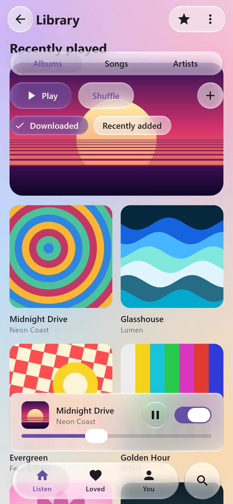
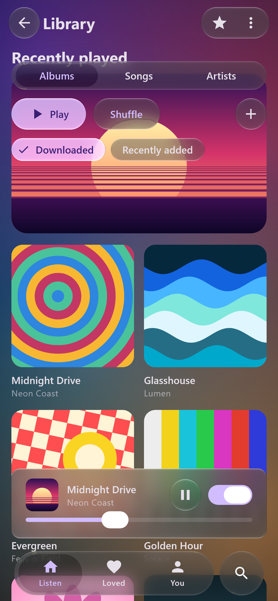

# Material 3, in Liquid Glass

`liquidglass-material3` has a Liquid Glass version of the Material 3 components, with the same
names and parameters. An app that uses Material 3 changes its imports and gets iOS 26's glass,
shapes and motion in its own colour scheme.

<p align="center">
  
  
</p>
<p align="center"><sub>Rendered by the library (desktop Skia, 390 × 844 dp at density 3, scaled down), scrolled so the album art passes under the glass, from Material's default light and dark schemes; only the imports differ from a Material 3 app. The same screen runs on Android and in the browser. <a href="https://github.com/shayann07/liquidglass/blob/main/review/atlas/material3-polish-2026-10-20/README.md">Evidence and limits</a>; <a href="https://github.com/shayann07/liquidglass/blob/main/review/atlas/showcase-2026-10-19/README.md">earlier renders and Pixel 7 captures</a>.</sub></p>

[Try it in your browser](demo.md#material-3). The change is the imports:

```kotlin
// before
import androidx.compose.material3.Scaffold
import androidx.compose.material3.NavigationBar
import androidx.compose.material3.NavigationBarItem
// after
import com.wexpa.liquidglass.material3.Scaffold
import com.wexpa.liquidglass.material3.NavigationBar
import com.wexpa.liquidglass.material3.NavigationBarItem
```

Use explicit imports for the glass components. They take precedence over a
`import androidx.compose.material3.*` star import, so `Text`, `Icon`, `MaterialTheme` and everything
else keep coming from Material.

```kotlin
MaterialTheme(colorScheme = darkColorScheme()) {
    Scaffold(
        topBar = { TopAppBar(title = { Text("Inbox") }, actions = { IconButton(onClick = {}) { Icon(Icons.Default.Edit, null) } }) },
        bottomBar = {
            NavigationBar(accessory = { Icon(Icons.Default.Search, null) }, onAccessoryClick = { /* search */ }) {
                tabs.forEachIndexed { i, tab ->
                    NavigationBarItem(selected = i == selected, onClick = { selected = i },
                        icon = { Icon(tab.icon, null) }, label = { Text(tab.label) })
                }
            }
        },
        floatingActionButton = { FloatingActionButton(onClick = {}) { Icon(Icons.Default.Add, null) } },
    ) { padding ->
        LazyColumn(contentPadding = padding) { /* the list scrolls under the glass */ }
    }
}
```

The glass `Scaffold` is the root: it records the screen once and every glass component and
`Modifier.glassEffect` below it refracts it. Without the glass `Scaffold`, wrap the screen in
`LiquidGlassTheme { }`.

## What each component becomes

<p align="center">
  
  
</p>
<p align="center"><sub>Every component over diagonal colour bands, so each glass edge crosses a boundary and shows its refraction. Rendered by the library (desktop Skia, 390 × 844 dp at density 2) by <code>GlassMaterialCatalogueTest</code>. <a href="https://github.com/shayann07/liquidglass/blob/main/review/atlas/glass-quality-2026-10-18/README.md">All renders</a>.</sub></p>

| Material 3 | Glass version (iOS 26 look, your colours) |
| :-- | :-- |
| `Scaffold` | records the screen for everything glass in it; content runs under the bars |
| `NavigationBar`, `NavigationBarItem` | iOS's floating tab bar: a glass capsule with a lens you can tap, hold, drag and throw. `accessory` adds the round search button that the bar fuses with |
| `TopAppBar`, `CenterAlignedTopAppBar`, `MediumTopAppBar`, `LargeTopAppBar` | no container; the navigation icon in a round glass button, the actions grouped on one glass capsule |
| `BottomAppBar` | the actions on a floating glass capsule (iOS's toolbar), the FAB beside it |
| `NavigationRail`, `NavigationRailItem` | a floating glass panel |
| `Button` | prominent glass (SwiftUI's `.glassProminent`), tinted with the primary colour |
| `FilledTonalButton` | glass tinted with the secondary container colour |
| `ElevatedButton`, `OutlinedButton` | plain glass (SwiftUI's `.glass`) |
| `TextButton` | no glass, as an iOS borderless button; pass `glass` to add it |
| `IconButton`, `FilledIconButton`, `FilledTonalIconButton`, `OutlinedIconButton` | round glass buttons; inside a bar's capsule they draw no glass of their own |
| `FloatingActionButton`, `SmallFloatingActionButton`, `LargeFloatingActionButton`, `ExtendedFloatingActionButton` | prominent glass tinted with `containerColor` |
| `Card` (both), `ElevatedCard`, `OutlinedCard` | frosted glass panels; a clickable card is interactive glass |
| `AssistChip`, `FilterChip`, `InputChip`, `SuggestionChip` | glass capsules; a selected chip is prominent glass |
| `Switch` | an iOS switch: the thumb turns into a glass lens while pressed |
| `Slider` | iOS's thin continuous track in the primary colour, running under the thumb's whole travel; the thumb turns into a glass lens while dragged |
| `SingleChoiceSegmentedButtonRow`, `SegmentedButton` | iOS's segmented control: a glass capsule with a lens selection |
| `MultiChoiceSegmentedButtonRow`, `SegmentedButton(checked)` | a glass capsule; checked segments are prominent glass |
| `PrimaryTabRow`, `SecondaryTabRow`, `TabRow`, `Tab` | the same segmented control |
| `ScrollableTabRow` | Material's tabs scrolling inside a glass capsule |
| `SearchBar`, `DockedSearchBar` | a glass capsule field and, while active, a glass results panel (the classic `query`/`active` parameters) |
| `AlertDialog`, `BasicAlertDialog` | an iOS alert: a glass panel over a light scrim |
| `ModalBottomSheet`, `rememberModalBottomSheetState` | an iOS sheet: a floating glass panel; drag down or tap outside to dismiss |
| `DropdownMenu`, `DropdownMenuItem` | an iOS menu: a glass panel under its anchor |
| `Snackbar` (both) | a glass capsule |
| `IconToggleButton`, `FilledIconToggleButton`, `FilledTonalIconToggleButton`, `OutlinedIconToggleButton` | round glass buttons: plain glass when off, prominent glass when on |
| `ElevatedAssistChip`, `ElevatedFilterChip`, `ElevatedSuggestionChip` | the glass chips (glass carries its own depth) |
| `RangeSlider` | iOS's thin track filled between two thumbs, each a glass lens while dragged |
| `Surface` (both) | a frosted glass panel; `color` tints it |
| `TooltipBox`, `PlainTooltip`, `RichTooltip` | a glass capsule or panel in the app's window, placed by Material's position provider; long press or hover shows it |
| `ModalDrawerSheet`, `DismissibleDrawerSheet`, `PermanentDrawerSheet`, `NavigationDrawerItem` | iPadOS's sidebar: a floating frosted panel inside Material's drawer; the selected item is a prominent glass capsule |
| `DatePickerDialog`, `TimePickerDialog`, `DatePicker`, `DateRangePicker` | a glass dialog in the app's window; the pickers lose their opaque container |
| `LeadingIconTab`, `PrimaryScrollableTabRow`, `SecondaryScrollableTabRow` | glass segments; Material's scrolling tabs in a glass capsule |

Text fields, checkboxes, radio buttons, progress indicators, dividers, badges and list items have no
container that iOS draws as glass, so they keep coming from Material.

<p align="center">
  
  
</p>

Every component takes a `glass` parameter (`Glass.Regular`, `Glass.Clear`, a tint, or
`Glass(GlassStyle(...))`) for full control. Large surfaces (cards, dialogs, sheets, menus, snackbars
and the search results panel; `SearchBar` takes it as `panelGlass`) default to
`GlassMaterialDefaults.panel`: the same glass over a frosted backdrop, as iOS draws its sheets and
alerts, so text behind a panel does not smear along its edge. All of it carries iOS 27's measured
rim (`GlassMaterialDefaults.control`): a bright chamfered edge whose highlight wraps round the
shape from straight above and below, a dark contour outside the outline at the unlit sides, and no
colour fringes. Controls default to unblurred glass;
on a panel they take the panel's frost, because glass on glass samples the page under the panel. The bars and the navigation bar take
`layout = GlassLayout.Material` to keep Material's own full-width layout, made of glass.

## Behaviour and limits

- Dialogs, sheets and menus are drawn in the app's window, in `GlassOverlay`, not in a separate
  window. That is what lets their glass refract the screen behind them. The platform's back gesture
  dismisses them (and tooltips) through Compose's navigation-event dispatcher, which Compose
  provides everywhere. On Android it is the system back. On desktop and the web, Compose
  Multiplatform sends Escape as back. A host that provides no dispatcher gets no back
  dismissal, and nothing fails.
- `SheetState` supports `show()`, `hide()`, `expand()`, `partialExpand()`, `isVisible`,
  `currentValue`, `targetValue` and `hasPartiallyExpandedState`. A sheet taller than half the window
  opens at a partially expanded stop showing half of it (iOS's medium detent), unless
  `skipPartiallyExpanded`. Dragging settles at the nearest stop, and a fast flick moves one stop.
- The navigation bar draws each item's icon and label twice (on the bar and inside the lens), so
  keep them the same shape and let the colours change.
- The limits of glass apply: glass draws above other content, and fading a parent does not fade it
  ([limitations](limitations.md)).

Evidence: [review/atlas/material3-2026-10-18](https://github.com/shayann07/liquidglass/blob/main/review/atlas/material3-2026-10-18/README.md).
