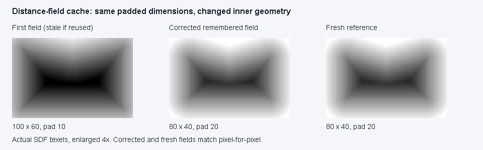
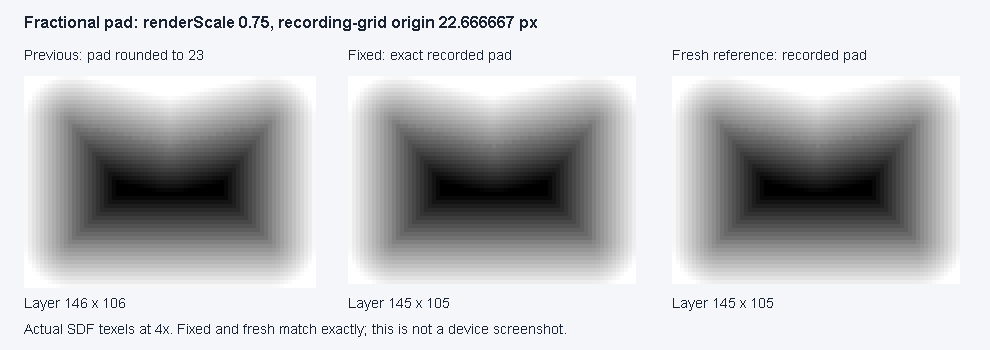

# Compose cache and field maintenance

Implementation based on upstream `4cd5ed8` (20 October 2026), addressing issues 80–82.
PR #83's review follow-up lowers retained storage and uses matching cache/build inputs:
whole-pixel size and exact recording-grid padding. No shader, material parameter, motion constant, field resolution or published
API change.

## Changes

- A remembered lease reference-counts views of the shared backdrop. Changing settings or leaving
  composition releases it; abandonment before effects run also releases the acquisition. Multiple
  active consumers share a view. Only active views are mirrored.
- Sampled-field keys include whole-pixel rounded size and exact recorded pad; outline construction
  and rasterization consume those same values. Padding is quantized only by `recordPad`, on the
  render-scale grid, to preserve the shader's origin. Style changes inside a grid bucket reuse
  the field; equal padded dimensions cannot hide different inner geometry.
- Shader-incapable backends skip field preparation.
- The full-resolution EDT uses reusable `inside`, `dx`, `dy`, distance and outer-distance buffers.
  The second transform reuses the first transform's working arrays; published bitmaps own their
  output. A single nonblocking pool retains up to 262,144 pixels of arrays (~4.25 MiB); larger or
  concurrent builds use temporary workspaces. The pool is shared across panels and is intentionally
  bounded, not a per-panel high-water allocation. It retains memory for the process lifetime.

## Current probe after review: 256k-pixel retained cap

Same environment and paired method described below, with a 512×256 panel added to exercise the
retained path. Mode 2 is the production pool policy: reuse below the cap, temporary storage above it.
All three sizes pass baseline/new pixel equality. These are calling-thread Java bytes, not total
process or native/GPU memory.

| Panel px | Mode | p50 ms | p95 ms | Java bytes/build (median) |
| --- | --- | ---: | ---: | ---: |
| 512×256 | Baseline | 9.7722 | 14.7801 | 6,811,344 |
| 512×256 | New, fresh | 9.7231 | 16.4850 | 4,768,528 |
| 512×256 | Production pool policy | 10.3019 | 15.7616 | 1,874,288 |
| 1080×300 | Baseline | 18.4575 | 20.9911 | 15,703,504 |
| 1080×300 | New, fresh | 19.9832 | 22.4556 | 10,993,040 |
| 1080×300 | Production pool policy | 20.2133 | 22.3204 | 10,993,072 |
| 1080×720 | Baseline | 40.5403 | 45.4263 | 34,653,904 |
| 1080×720 | New, fresh | 45.1652 | 59.7342 | 24,258,320 |
| 1080×720 | Production pool policy | 43.7376 | 47.6313 | 24,258,352 |

Allocation falls approximately 72.5% for the warmed small field and 30% for both large fields.
The latter no longer grow or use the retained workspace. New production-policy CPU medians are
slower in this run; allocation reduction is not a CPU speedup claim.

## Historical probe at `c1d2b5a`: superseded 1M-pixel retained cap

The following large-field 72.5% result describes the initial PR, **not the current pool policy**.
It is preserved to show the memory/allocation tradeoff requested in review.

Windows, Intel i7-10700, JBR/OpenJDK 25.0.3, Compose 1.12.2, Skiko 0.150.2. Direct field calls,
not shader rendering or presented frames. Baseline is the full-resolution implementation from
upstream `0d88a23`/Maven 1.0.0, with identifiers renamed to coexist in one test JVM.
New code uses the same rasterization, EDT arithmetic and encoding.

Notched closed path, 24 px pad, 48 px band, sizes in pixels. 40 warmups per algorithm/size, 25 samples,
alternating baseline/fresh/pooled and pooled/fresh/baseline order. Calling-thread Java allocations
from ThreadMXBean exclude native/GPU memory. Both new modes were compared pixel-for-pixel with the
baseline before timing. Fresh means a new workspace each call; pooled means already-grown arrays.

| Panel px | Mode | p50 ms | p95 ms | Java bytes/build (median) |
| --- | --- | ---: | ---: | ---: |
| 1080×300 | Baseline | 18.1797 | 21.2381 | 15,703,504 |
| 1080×300 | New, fresh | 18.0442 | 19.3340 | 10,993,040 |
| 1080×300 | New, pooled | 18.0013 | 18.4379 | 4,319,632 |
| 1080×720 | Baseline | 42.8784 | 45.9413 | 34,653,904 |
| 1080×720 | New, fresh | 42.2618 | 44.0699 | 24,258,320 |
| 1080×720 | New, pooled | 41.0097 | 42.9107 | 9,530,992 |

An independent rerun using the checked-in benchmark reproduces all six allocation medians exactly.
Its baseline/fresh/pooled p50 values were 19.8868/20.9011/18.8772 ms at 1080×300 and
45.2805/47.1228/47.4968 ms at 1080×720. Timing varies and the pooled case can be slower.

Approximately 72.5% fewer Java allocations after pool warmup, or 30% with fresh workspace creation.
This trades bounded retained scratch storage for less transient allocation. Median CPU changes
are small; no significant CPU speedup, Android FPS improvement or physical-device approval is claimed.
Full-resolution computation remains synchronous. An asynchronous or bounded-resolution policy is
separate future work and must preserve the geometry tests.

Reproduce from repository root (JDK 21+):

```sh
./gradlew -I tools/benchmarks/pathfield.init.gradle :liquidglass:jvmTest \
  --tests '*FieldAllocationBenchmarkTest' --rerun --max-workers=2
```

The benchmark sources are opt-in under `tools/benchmarks/pathfield`; they do not enter the normal
test suite or a published artifact.

## Cache geometry comparison



Source: this change's `CacheFieldVisualTest`, candidate based on `4cd5ed8`, desktop JVM/Skia
software rasterization on the environment above. The test changes a notched path from 100×60
with pad 10 to 80×40 with pad 20; both use a 120×80 padded layer. Left is the actual first field
(the stale result the old key reused), middle is the corrected remembered field, right is a fresh
reference. Actual stored texels are enlarged 4× and annotated with Java2D; all middle/right pixels
are asserted equal before export. Visually inspected. This is a field diagnostic, not an app
screenshot, physical-device validation or frame-time evidence.

Reproduce with the same opt-in init script and `--tests '*CacheFieldVisualTest' --rerun`.
Output: `liquidglass/build/reports/atlas/compose-cache-field/field-cache.png`.

## Initial verification at `c1d2b5a`

- Before changes: lifecycle and geometry-cache reproductions fail (2 tests).
- Focused candidate: lifecycle, field-cache, buffer reuse/concurrency and existing field/odd-pad
  tests pass. Coverage includes shared consumers, superseded settings, portal/overlay disposal,
  abandoned leases, identical-input reuse, disabled capability, alternating sizes/shapes/padding,
  immutable prior outputs and concurrent builds.
- Paired allocation probe passes and checks identical baseline/new pixels at both measured sizes.
- Full renderer invocation: 423 tests, 393 passed, 27 opt-in showcase cases skipped, three
  `UncompletedCoroutinesError` timeouts. Four renderer workers, 768 MiB each, 17m38s.
  This first invocation failed; it is not reported as a clean full-suite pass.
- Unchanged-source rerun with one renderer worker: all three timed-out cases pass, along with
  `CacheFieldVisualTest` and `FieldAllocationBenchmarkTest` (5 tests, 4m). The retried cases are
  `GlassSurfaceDesktopTest.desktopPressIsPreservedWhileOnlyLargeSurfaceDragBecomesSubtle`,
  `GlassTabBarCalmGestureTest.aCancelAfterCrossingTabsSelectsNothingAndSettlesBack` and
  `GlassTabBarGestureTest.aDeclinedDragReturnsTheSelectorToTheSelectionTheHostHolds`.
  An isolated thread dump showed native Skia rendering during the surface test. This supports
  a timing/environment explanation but does not prove its root cause.
- `:sample:assembleDebug`, `:liquidglass:compileKotlinWasmJs` and
  `:liquidglass:checkKotlinAbi` pass. Strict MkDocs, repository links and whitespace checks pass.
- No physical-device run. Existing field/odd-pad render checks are the optical gates for this
  maintenance change; screenshots are not timing evidence.

## Review follow-up verification (`1654e90`, historical pad rounding)

- Added regression coverage for sub-pixel pad/size reuse, rounding-boundary invalidation and
  pixel equality with a build using the rounded inputs; existing equal-padded-size regression
  remains a gate.
- Added root-region replacement while nested leases are alive, oversized-build retention bounds,
  busy-pool independent storage and lock release after a build failure.
- Shader capability is read once at the production call site and explicitly passed to field
  preparation. `kotlinx-coroutines-core` is declared directly; the nonblocking Mutex is retained
  so concurrent/future off-composition callers remain safe.
- Focused regressions, existing field/odd-pad tests, packaged benchmark and field visualization
  pass: 22 tests, zero failures/errors/skips (1m28s). Regenerated field visualization is
  byte-identical to the inspected image above.
- Full `:liquidglass:jvmTest --rerun`: **427 tests, 400 passed, 27 opt-in showcase skips,
  zero failures/errors**, using one renderer worker with 768 MiB heap (27m04s for the combined
  command). No test assertions or timeouts were relaxed.
- The same command also passes `:sample:assembleDebug`, `:liquidglass:checkKotlinAbi` and
  `:liquidglass:compileKotlinWasmJs`, with `--max-workers=2`. The single test-worker setting was
  supplied through a local Gradle init script; the repository's build defaults are unchanged.
- Strict MkDocs, all 138 repository/visual links and whitespace checks pass.
- The maintainer separately reported the initial `c1d2b5a` suite passing on Windows/JDK 21:
  423 tests, zero failures, 27 opt-in skips. This is reviewer-reported evidence for the initial
  revision, not a substitute for the current local verification.

## CodeRabbit fractional-padding follow-up

The previous checkpoint rounded `recordPad` to an integer before building a field. At a reduced
render scale, that value is already quantized to the recording grid and can be fractional in
layer coordinates. For a 22.1 px requirement at scale 0.75, `recordPad` returns 22.666667 px;
rounding it to 23 moves the field away from the shader's origin.

The fix retains the exact recorded pad in both the key and rasterization. Size remains rounded
to whole layout pixels. The transform algorithm, scratch policy and shader formulas are unchanged,
so the existing integer-geometry allocation measurements above remain applicable.

- Red regression on `1654e90`: expected layer width 145, actual 146. Raw test output was archived.
- Green focused run: **21 tests/probes, zero failures/errors/skips in 41s**. Production `recordPad`
  supplies the test inputs. Scales 1, 0.75, 0.6, 0.5 and 0.25 match fresh reference fields texel
  for texel. Within-grid style changes reuse the field; crossing a pad or size bucket rebuilds.
- Full `:liquidglass:jvmTest --rerun`: **428 tests, 401 passed, 27 opt-in showcase skips,
  zero failures/errors**. The combined command took 28m45s with one 768 MiB test worker and
  `--max-workers=2`; Android sample assembly, Wasm compilation and Kotlin ABI checks also pass.
  No assertions or timeouts were relaxed. Strict MkDocs and all 139 repository/visual links pass.



Source: working-tree follow-up to `1654e90`, Desktop JVM/Skia on Windows, JDK 25.0.3.
Capture: opt-in `CacheFieldVisualTest.renderFractionalPaddingOrigin`, using the production
Compose helper and a fresh direct-build reference. The left field reconstructs the former
double rounding. Real SDF texels are enlarged 4× and inspected; fixed/reference texels match exactly.
This is a field diagnostic, not an app/device screenshot, frame-time measurement or owner acceptance.
