# Material 3 showcase polish (#79) — 20 October 2026

The owner's review of the web demo's Material 3 page found three defects. Two are in the demo
content; one is in the library.

| Defect | Cause | Fix |
| :-- | :-- | :-- |
| The slider thumb hangs past the end of its track | **Library.** Material lays a slider's track out between the thumb's centre positions, half a thumb (19 dp) in from each end. `GlassSliderTrack` and `GlassRangeTrack` drew inside that box and inset another half thumb, so the capsule stopped short of the thumb's travel | Both tracks draw half a thumb past each end of their box, so the capsule runs under the whole thumb as iOS's does; the fill ends at the thumb's centre. `Slider`/`RangeSlider` signatures are unchanged |
| The switch and the play button crowd the card's edge | **Demo.** The mini player's content was inset 14 dp, with no gap between the 48 dp button and the switch | 20 × 14 dp inset and a 10 dp gap |
| The play button showed a refresh arrow while playing | **Demo.** The core icon set has no pause glyph; `Icons.Default.Refresh` stood in | Material's pause path, drawn as a local `ImageVector` |
| "Recently played" is one large empty gradient | **Demo.** On a desktop window the full-width 1.6:1 cover was taller than the screen, so only the top of its sky showed | The cover keeps 1.6:1 on a phone and is capped at 280 dp tall on a wide window |

## The mini player (phone)

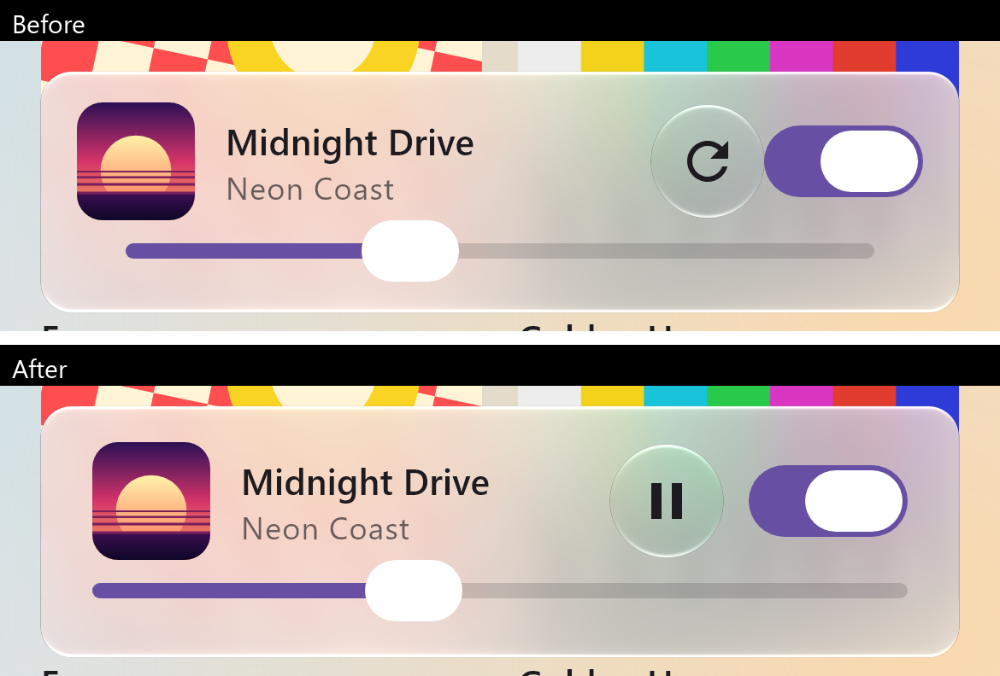

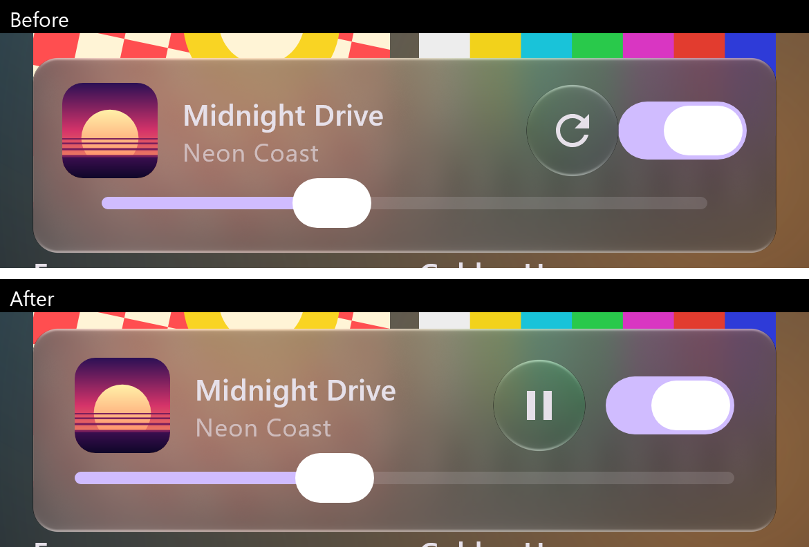

*`MaterialShowcaseRenderTest.scrolled` / `scrolledDark` (desktop JVM, Skia raster, 390 × 844 dp at
density 3), cropped to the mini player. Before: `origin/main` at `4cd5ed8`; after: this change.*

## A desktop browser window

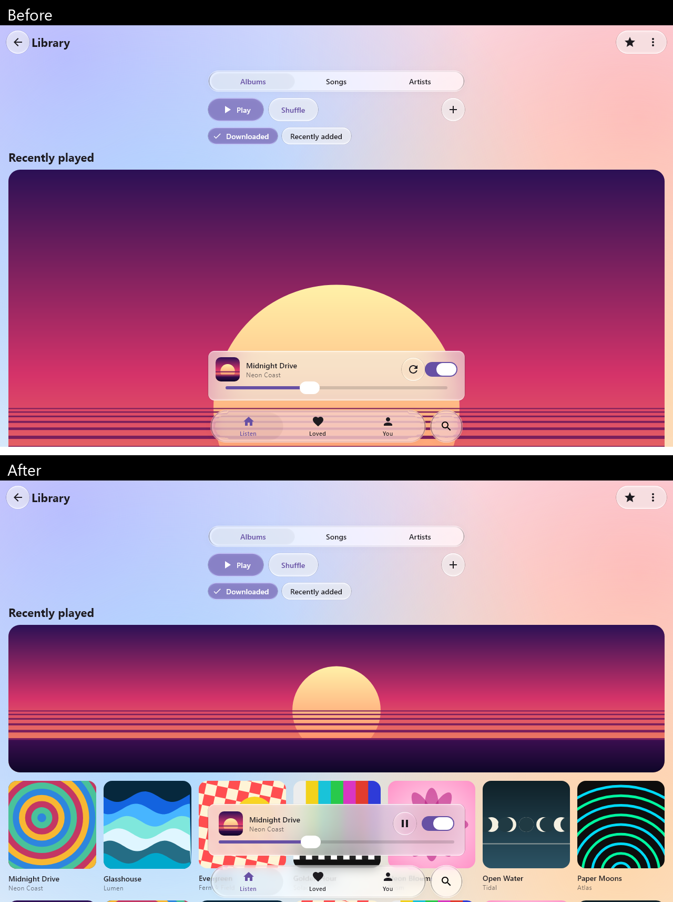

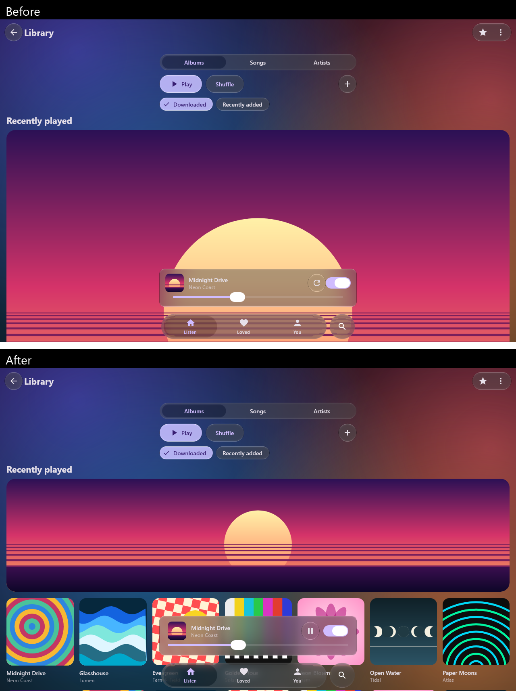

*`MaterialShowcaseRenderTest.wide` / `wideDark` (new): 1280 × 800 dp at density 1, the size the web
demo is usually seen at. Desktop JVM Skia raster, not the browser build.*

## On a Pixel 7

| The screen | The slider dragged to each end |
| :-: | :-: |
| 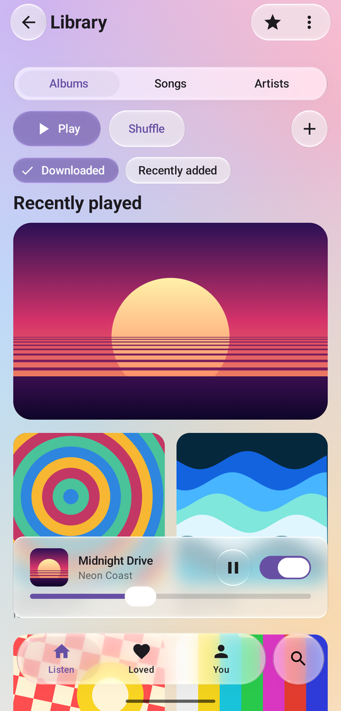 | 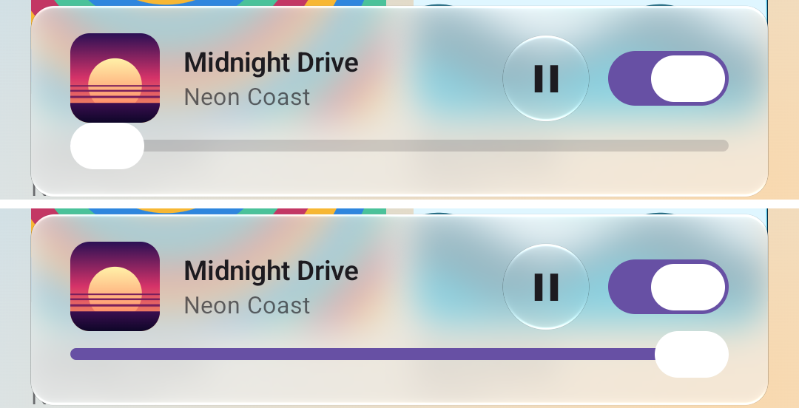 |

*Pixel 7, Android 17, the sample's `MaterialShowcaseActivity` (release build signed with the debug key,
this change). `adb exec-out screencap -p`; the status bar is cropped off and the screen scaled to half.
Right: `adb shell input swipe` along the track to each end (600 ms), captured 1.5 s after release and
cropped to the mini player. adb input is not a finger.*

## In the browser

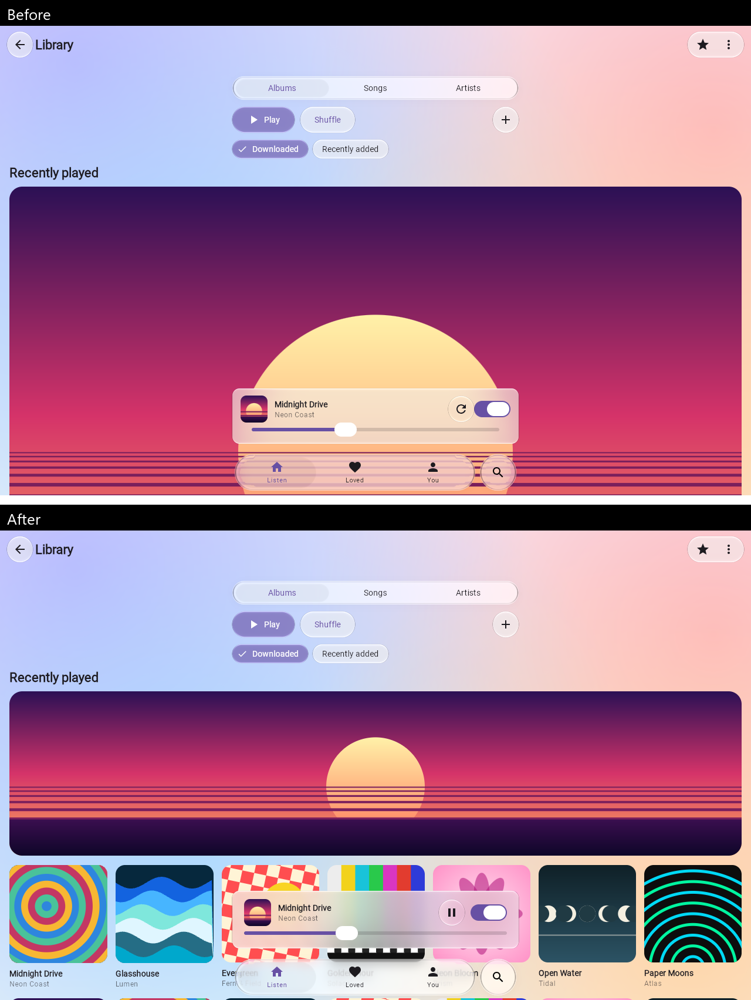

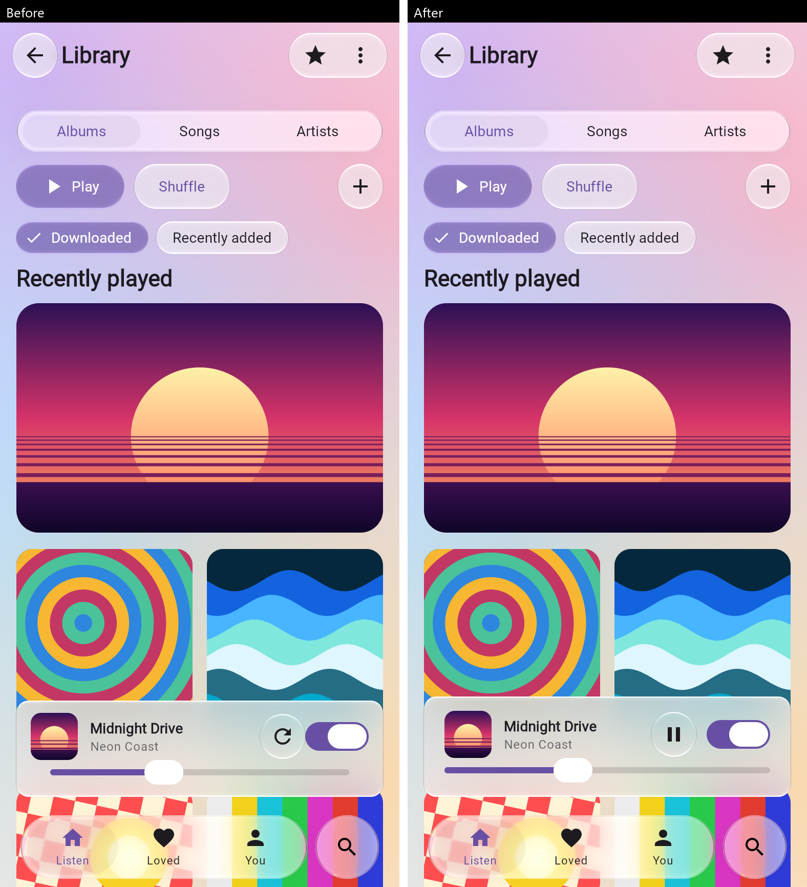

*The web demo (`apps/web`, Compose for Web on WebAssembly), `#material3`, in headless Chrome 152 on
ANGLE/D3D11 (AMD Radeon integrated graphics), served locally. Before: `origin/main` at `4cd5ed8`; after:
`ec13798`, this PR's head before these captures were added. 1280 × 800 at device scale 1, and 390 × 844
at device scale 2; captured 2 s after the first frame with app pixels in it. A local build, not the live
site, whose loading is #78.*

## The menu, dialog, sheet and tooltip

These open on interaction, so the renders above do not show them. Each was opened on the showcase in
the browser and inspected; none had a defect, and none is changed here.

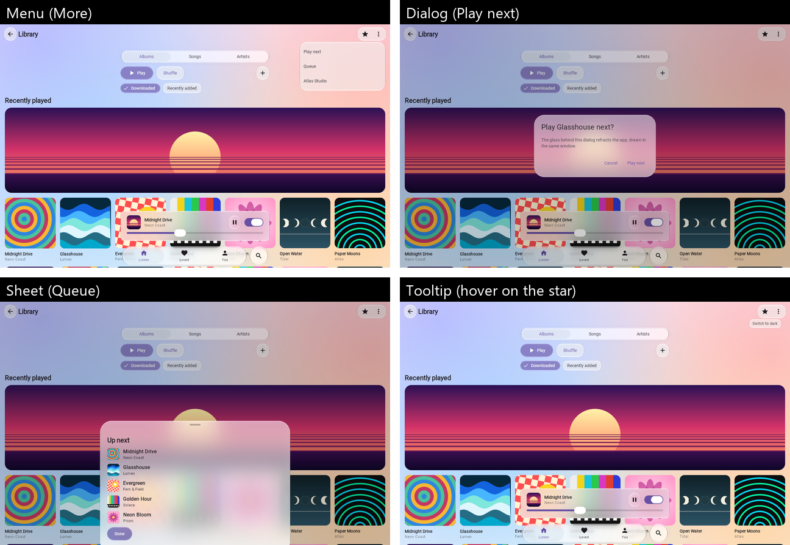

*The web demo (`ec13798`), `#material3`, headless Chrome 152 on ANGLE/D3D11, 1280 × 800, scaled to half.
Menu: a click on More. Dialog and sheet: More, then "Play next" or "Queue". The sheet opens at its
half-window stop (the documented partially expanded state) and the rest is reached by dragging it up.
Tooltip: a mouse hover on the star, captured 0.6 s later; Material's non-persistent tooltip hides
itself after about 1.5 s.*

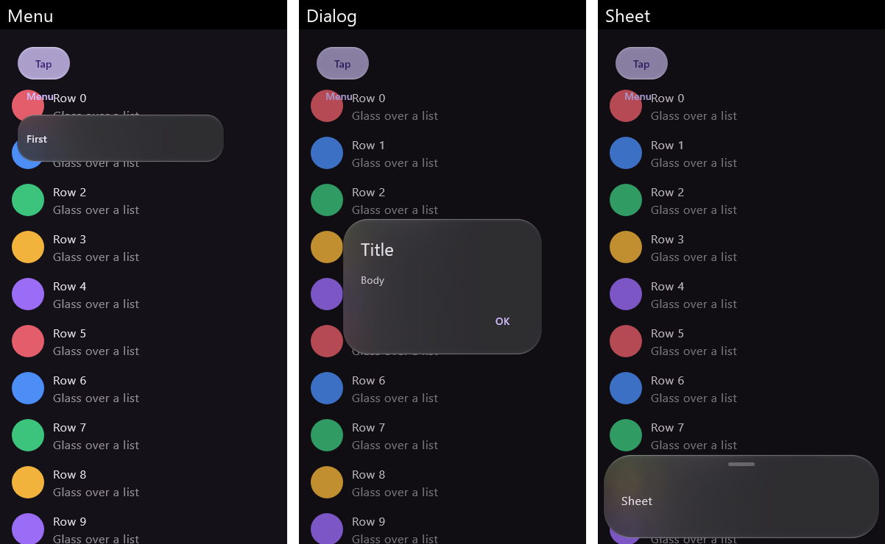

*Desktop JVM Skia raster, `GlassMaterialComponentsTest.buttonsClickAndOverlaysOpenAndDismiss`
(390 × 700 dp at density 1), which also checks that each one opens and dismisses; this change's
working tree before commit `3fcc9a7`. `togglesToggleAndALongPressShowsATooltip` checks the tooltip by a
touch long press; it saves no image.*

## The new renders

| Light | Dark |
| :-: | :-: |
| 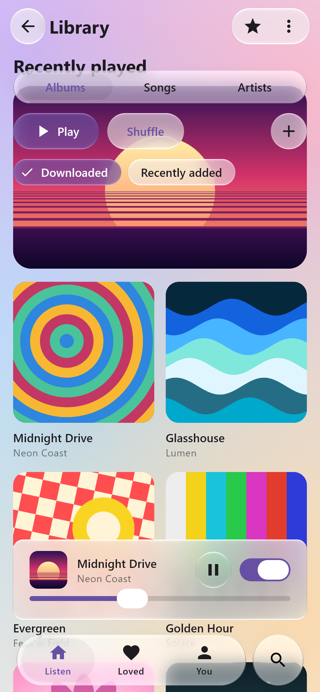 | 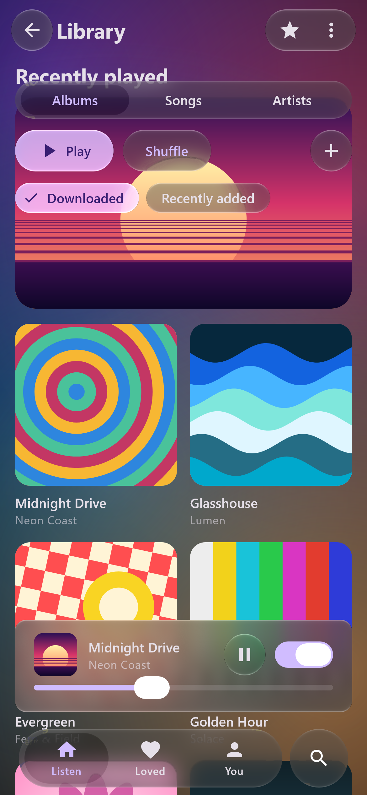 |

*`MaterialShowcaseRenderTest.scrolled` and `scrolledDark` after the change. They replace the README's
hero images and, scaled to 780 × 1688, `docs/assets/material3-light.png` / `-dark.png`. The
19 October renders stay in [showcase-2026-10-19](../showcase-2026-10-19/README.md).*

## Checks

- `GlassSliderTrackTest` (new): renders `Slider` at 0.5 and `RangeSlider` at 0.25..0.75 in pure
  red/blue on black and scans the track's row. Before the fix both failed ("the track starts 19 px
  in"); after it, the track reaches both ends of the slider and the range fill reaches both thumbs.
- `GlassSliderTrackTest` also pins both ends with the thumb at rest (review follow-up): at 0 no fill
  shows outside the thumb and the track reaches the slider's end; at 1 the fill runs from the start to the
  thumb and no unfilled track shows. The fill ends at the thumb's centre at every value, so a held,
  transparent lens shows fill under its left half at 0 and track under its right half at 1, as midway.
  All four slider tests fail against the original inset track and pass with this change.
- `:liquidglass-material3:jvmTest`: 20 tests, 0 failures (catalogue 9, components 7, slider 4).
- `:desktop:desktopTest --tests '*MaterialShowcaseRenderTest*'`: 6 renders, inspected.
- `checkKotlinAbi`: the public API is unchanged (internal drawing only).
- `:web:compileProductionExecutableKotlinWasmJs`, `:sample:assembleRelease`, strict MkDocs and
  `check_repo_links.py` pass.

## Limits

- The renders are desktop Skia, the device capture is Android and the browser captures are one engine
  (Chrome on Windows). Firefox, Safari and phone browsers were not captured.
- The other components on the page (top bar, segmented control, buttons, chips, tab bar, and the menu,
  dialog, sheet and tooltip above) were inspected in the renders, the browser captures and against the
  18 October Pixel 7 captures; no other defect was found. That is an inspection, not a measurement.
