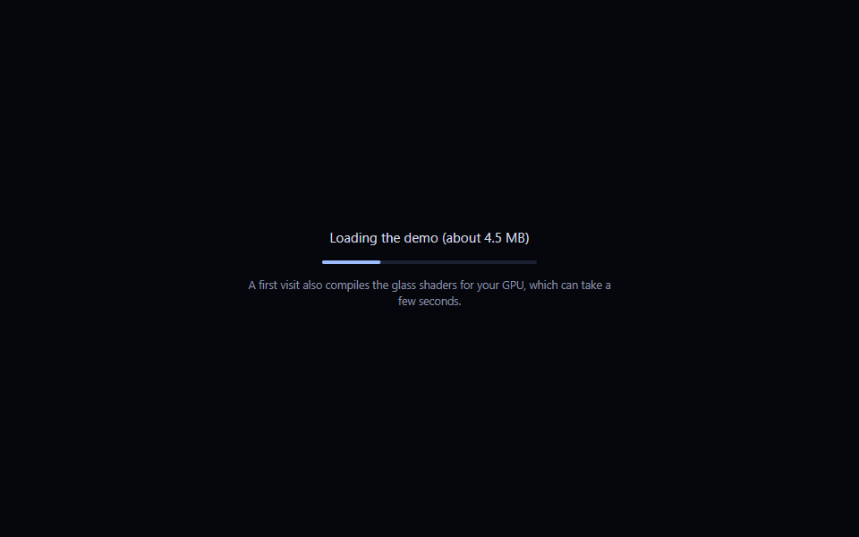
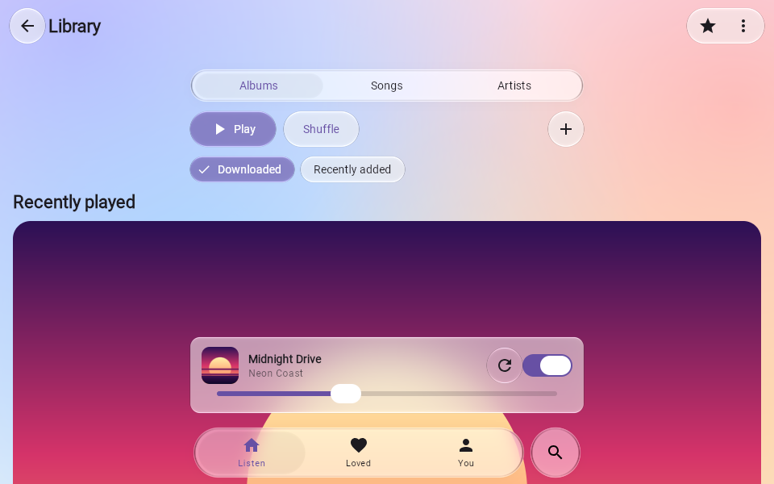
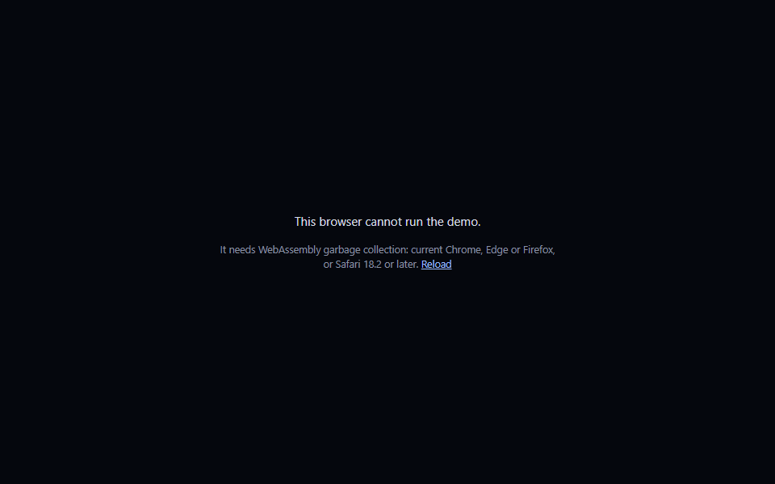
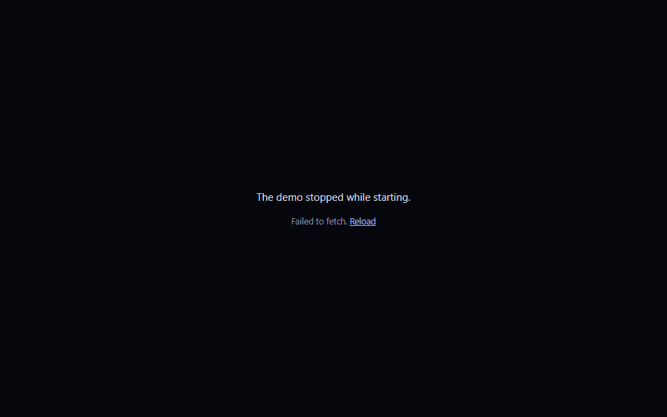
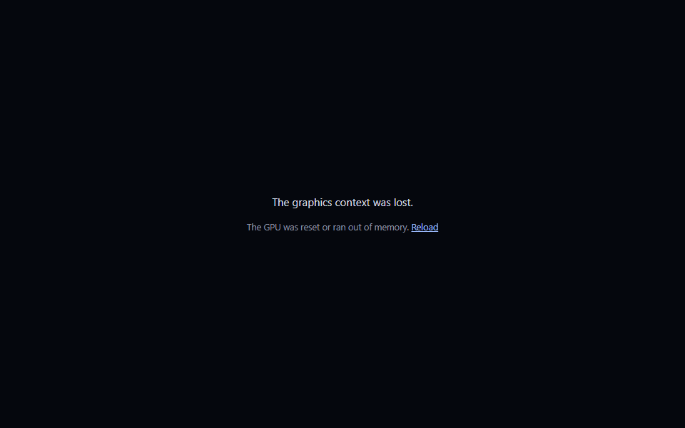

# The web demo's first load (#78) — 20 October 2026

The live demo (`apps/web`, Compose for Web on WebAssembly) showed a black page for a long time on its
first load and sometimes never rendered. Measured in Chromium, the black page had three causes, and
nothing on the page said which one was happening.

1. **The download: 4.46 MB (gzip).** `skiko.wasm`, Skia's WebAssembly runtime, is 3.28 MB of it
   (8.6 MB raw); the app is 1.08 MB (3.5 MB raw) and `atlas.js` 0.1 MB. GitHub Pages serves gzip, not
   brotli, so the transfer is fixed by Skia's runtime; this change does not make it smaller.
2. **The first frames compile the glass shaders.** On a first visit the opening frames take about 2 s
   each while the GPU compiles the effect chains (intervals between frames from `requestAnimationFrame`:
   250, 233, **2033, 2450, 2250**, 17 ms). Chrome caches the compiled shaders, so a second visit in the
   same browser takes about 130 ms per opening frame. This is the web side of the Android first-use hitch (#71).
3. **Failures were silent.** The generated loader rethrows a failed Wasm instantiation from a top-level
   await, so a missing feature or a failed download left a black page with one console line. Neither
   Compose nor Skiko restores a lost WebGL context, so a GPU reset during those heavy first frames
   left the canvas blank for good.

## What changed

- **A loader** (`index.html`) shows from the first paint, says what is being loaded, then "Preparing
  the glass" once the Wasm has started. Its bar is a transform animation, so it keeps moving while the
  main thread is busy compiling shaders. `Main.kt` hides it once three frames in a row each follow the
  previous one within 100 ms, so the half-drawn shader-compile frames are not shown (one quick frame can
  come before a slow one). After 60 frames without that it shows the app anyway (logged to the console):
  a device that never draws frames that fast would otherwise keep the loader up for good. A failure
  reported meanwhile is never replaced by "ready". The context-loss listener is attached once per
  canvas. (Review follow-ups after `ba932e2`; the measurement tables and the five state screenshots are
  from `ba932e2`.)
- **Compose has its own container** (`#app`). `ComposeViewport(document.body)` replaced the body's
  children, which would have removed the loader on mount.
- **Failures are reported on the page** with a Reload link: no WebAssembly GC (checked before
  anything downloads), a failed download or uncaught error while starting, and a lost WebGL context
  at any time. The canvas lives in Compose's shadow root, where `webglcontextlost` does not reach
  `window`, so the listener is attached to the canvas when its context is created.
- **The docs page loads each demo lazily, as it approaches the viewport** (`loading="lazy"` on both iframes
  in `docs/demo.md`). They loaded together before: two 4.5 MB downloads and two shader compilations at once.
- No favicon request (it was a 404).

## Measurements

[`tools/measure_web_demo.mjs`](../../../tools/measure_web_demo.mjs) serves a build the way GitHub Pages
does (gzip, `max-age=600`) and loads `#material3` in headless Chrome 152 with a fresh browser per run, so
HTTP and shader caches are cold. "Black" is the time from navigation to the first visible pixel that is
not the page background: the loader after this change, the app's first frame before it. Windows, AMD
Radeon integrated graphics through ANGLE/D3D11, 1280 × 800. Throttling is CDP network emulation.
Three runs each; the before build is `origin/main` at `4cd5ed8`, the after build is `ba932e2`.

| Network | Black page, before | Black page, after | App visible, before | App visible, after |
| :-- | --: | --: | --: | --: |
| none (local) | 7.6 / 7.9 / 7.8 s | **0.08 / 0.05 / 0.05 s** | 7.6 / 7.9 / 7.8 s | 7.5 / 7.4 / 7.5 s |
| fast 4G (9 Mbit/s, 40 ms) | 11.6 / 11.6 / 11.3 s | **0.12 / 0.09 / 0.10 s** | 11.6 / 11.6 / 11.3 s | 11.4 / 11.3 / 11.6 s |
| slow 4G (1.6 Mbit/s, 150 ms) | 30.6 / 30.1 / 30.5 s | **0.20 / 0.19 / 0.21 s** | 30.6 / 30.1 / 30.5 s | 30.3 / 31.4 / 32.8 s |

The time until the app is usable is unchanged: it is the download plus the shader compilation. What
changed is that the page explains it from the first tenth of a second instead of staying black. Before
the change the live site measured the same (`https://liquidglass.shayxo.dev/demo/#material3`: first
frame at 18.0 s on fast 4G and 39.3 s on slow 4G, a single cold run each with a shared browser).

**Re-check after the review follow-ups** (the three-frame settle, the once-per-canvas listener): the
same script, three cold runs unthrottled and one on slow 4G. Loader at 62 / 49 / 45 ms, app visible at
7.6 / 7.2 / 7.8 s; slow 4G 0.21 s and 30.8 s. The same as `ba932e2`, and the five states and the
failure-during-settling case behave as before.

## The page's states

| Loading | Ready |
| :-: | :-: |
|  |  |
| **No WebAssembly GC** | **Download failed** |
|  |  |
| **Graphics context lost** | |
|  | |

*Headless Chrome 152 on ANGLE/D3D11 (AMD Radeon integrated graphics), 960 × 600, the `ba932e2` build
served locally. Loading: throttled to 1.6 Mbit/s
and captured 3 s in. No WebAssembly GC: `WebAssembly.validate` stubbed to return false. Download failed:
Playwright aborts every `.wasm` request. Context lost: `WEBGL_lose_context.loseContext()` on the
app's canvas after it is ready. The same five scenarios on the before build all show a black page.
This branch does not include the #79 Material 3 fixes, so the mini player still has its old icon.*

## Limits

- One machine and one browser engine. Not measured: Firefox, Safari, phones. The failure states are
  forced in Chromium; the WebAssembly GC check is the feature test, not a real old browser.
- A permanent black page was not reproduced in Chrome on this machine apart from a hidden window (a
  background tab does not draw until it is shown). The reported "never renders" may have been one of the
  failures above, a hidden tab, or a slow download; each of those now shows on the page.
- The download and the shader compilation are not reduced. Smaller transfers need brotli, which GitHub
  Pages does not serve; compiling shaders before the first frame only moves the cost (#71).
